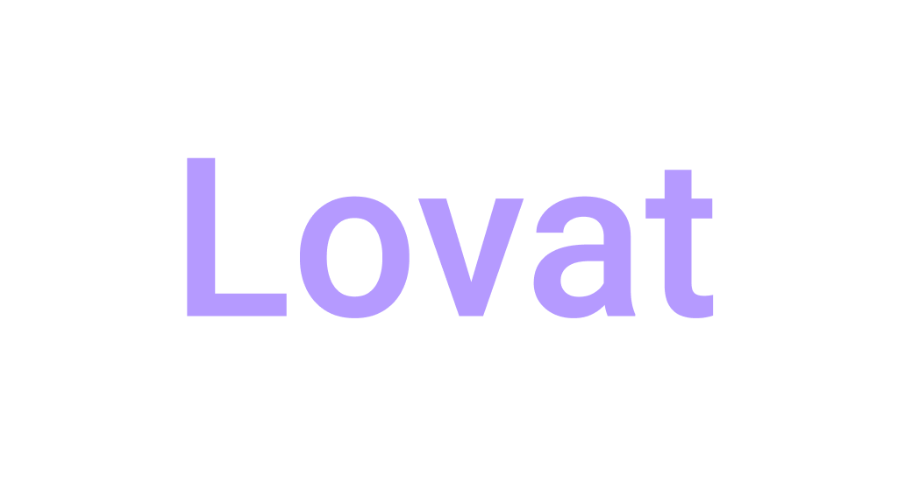

<h1 align="center">
  
</h1>

FIRST Robotics Competition scouting by Highlander Robotics, Team 8033.

  <a href="https://lovat.app">Website</a> ·
  <a href="https://dashboard.lovat.app">Dashboard</a> ·
  <a href="https://learn.lovat.app">User guides</a> ·
  <a href="docs/README.md">Developer docs</a>

Lovat records match observations, keeps reports available offline, and turns submitted data into analysis, predictions, and picklists for scouting and strategy teams.

## Download the apps

The version badges show the public iOS App Store release. Google Play versions can differ.

**Collection**

  
  

**Dashboard**

  
  

## Applications

| App | What it does | Stack |
| --- | --- | --- |
| [Collection](apps/collection/README.md) | Records matches on iOS and Android, works offline, and uploads reports. | Expo, React Native, TypeScript |
| [Dashboard](apps/dashboard/README.md) | Analyzes reports and manages scouting schedules, predictions, and picklists. | Flutter, Dart |
| [Dashboard (Tauri)](apps/dashboard-tauri/README.md) | In-progress rewrite of the Dashboard for web, desktop, and mobile. | Svelte, TypeScript, Tauri, Rust |
| [Server / API](apps/server/README.md) | Authenticates clients, validates and stores reports, and serves analysis. | Node.js, Express, Prisma, PostgreSQL, Redis |
| [Worker](apps/worker/README.md) | Runs background jobs, including tournament, match, and results imports from The Blue Alliance. | Bun, TypeScript, PostgreSQL |
| [Website](apps/website/README.md) | Serves the public site and selected integrations. | SvelteKit, TypeScript |
| [Learn](apps/learn/README.md) | Publishes app guides and API onboarding. | Astro, Starlight, MDX |

[Shared database package](packages/db/README.md) · [Architecture and data flow](docs/architecture.md)

## Working here

1. Read [AGENTS.md](AGENTS.md) and the nearest app-local instructions before editing.
2. Follow the app's README or the [local development guide](docs/development/README.md) for tools, environment variables, and commands. Each app keeps its own lockfile.
3. Run the affected app's checks and `./scripts/check-structure.sh` from the repo root.

[Testing and CI](docs/testing/README.md) · [Deployment and previews](docs/deployment/README.md) · [All developer docs](docs/README.md)

## History

[Changelog](CHANGELOG.md) · [Retained commit archive](docs/history/README.md) · [Monorepo migration and source maps](docs/migration/README.md)
