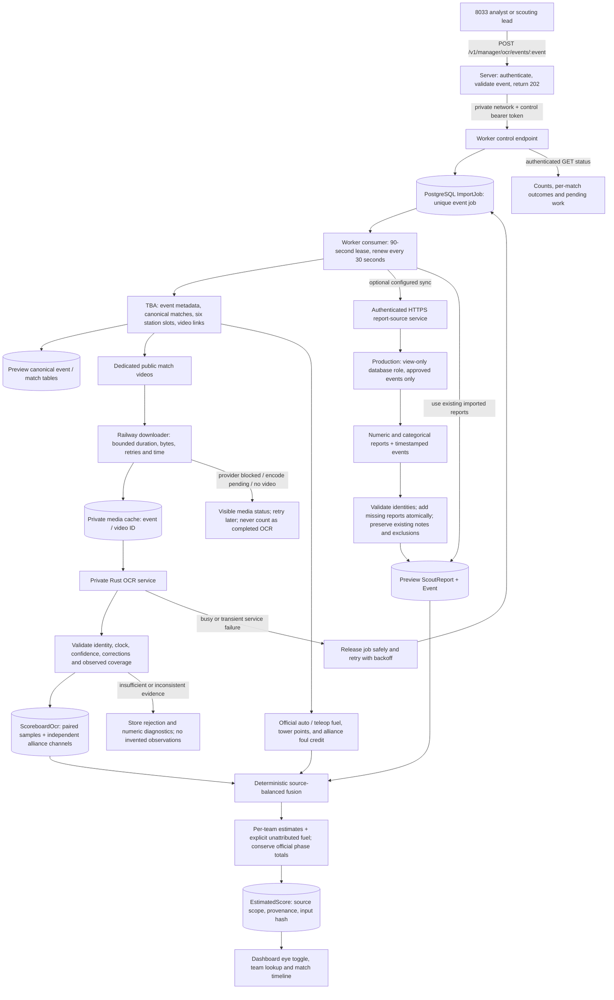

# Lovat

[](https://github.com/HighlanderRobotics/lovat/actions/workflows/ci.yml?query=branch%3Amain)
[](https://github.com/HighlanderRobotics/lovat/actions/workflows/ci.yml?query=branch%3Amain)
[](https://github.com/HighlanderRobotics/lovat/actions/workflows/codeql.yml?query=branch%3Amain)

Lovat is Highlander Robotics Team 8033's scouting system for FIRST Robotics Competition events. It collects match observations, analyzes team performance, supports scouting operations, and presents data for match strategy and alliance selection.

## Applications

| Path | Purpose | Technology |
|---|---|---|
| [`apps/collection`](apps/collection) | Field-side match collection, offline history, and report upload | Expo, React Native, TypeScript |
| [`apps/server`](apps/server) | API, authentication, storage, imports, caching, and analysis | Node.js, Express, TypeScript, Prisma, PostgreSQL, Redis |
| [`apps/dashboard`](apps/dashboard) | Analysis, scouting management, predictions, and picklists | Flutter and Dart |
| [`apps/website`](apps/website) | Public site and selected operational routes | SvelteKit and TypeScript |
| [`apps/learn`](apps/learn) | User guides for Dashboard and Collection | Astro, Starlight, MDX, Svelte |

## Data flow

```text
Collection ── reports ──> Server <── schedules and results ── The Blue Alliance
                            │
                            ├── PostgreSQL: durable data
                            ├── Redis: analysis cache
                            └── authenticated API ──> Dashboard

Website provides public pages and selected operational integrations.
```

See [`docs/architecture.md`](docs/architecture.md) for boundaries and cross-application contracts.

## Railway OCR event analysis

The event endpoint queues durable work; it does not hold an HTTP request open while videos are analyzed. The initial operator scope is team 8033 and the approved 2026 events. Reports already copied into the PR database can be analyzed directly. An optional, separately provisioned bridge can sync numeric production reports; OCR evidence and estimates stay in the PR environment.

```mermaid
flowchart LR
    Video["Bounded match file"] --> Decode["One FFmpeg decoder; sample one frame / second"]
    Decode --> Identity["Match label + all six teams must agree on two frames"]
    Identity --> Crops["Crop clock and cumulative fuel numerators; optional point digits"]
    Crops --> Scale["Reuse scaler buffers; normalize grayscale / binary / glyph views"]
    Scale --> Cache["Exact-pixel crop cache; optional prepared-image cache with mode + byte checks"]
    Cache --> Tess["Persistent Tesseract engines; record field and stage timings"]
    Tess --> Clock["Convert displayed clocks to continuous 0–163 match seconds"]
    Clock --> Channels["Track red and blue independently; preserve gaps and quarantine corrections"]
    Channels --> Out["Bounded numeric response + runtime / model provenance"]
```





No robot receives guessed fuel merely to fill an OCR gap. Foul credit is kept at alliance level, and official endgame / autonomous points are accounted separately. A provider-blocked video is an availability failure, not an OCR result. See [the operational OCR guide](docs/scoreboard-ocr.md) and [fusion accounting](docs/scoreboard-fusion.md).

## Prerequisites

- Server: Node.js 22.20.0, PostgreSQL, and Redis.
- Collection: Node.js 24.6.0 and Expo/EAS tooling.
- Dashboard: Flutter; CI versions are documented in its local instructions.
- Website: Node.js 20.19.6.
- Learn: Node.js 22 and npm.
- macOS and Xcode are required for local iOS builds.

Each application retains its own lockfile. Install dependencies inside the application directory.

## Commands

```bash
./scripts/check-structure.sh
./scripts/check-all.sh
```

Application development commands:

```bash
cd apps/server && npm run dev
cd apps/collection && npm start
cd apps/dashboard && flutter run -d chrome
cd apps/website && npm run dev
cd apps/learn && npm run dev
```

Several applications require environment files or external services for full runtime behavior. Copy only committed `.env.example` files and never commit credentials.

## Working here

Read [`AGENTS.md`](AGENTS.md) and the nearest app-local `AGENTS.md` before editing. Keep changes within the app that owns the behavior. Update all affected producers and consumers together when a shared contract changes.

## Pull request review

Internal pull requests receive an automated OpenRouter review when they are opened, updated, reopened, or marked ready for review. The reviewer lives in [`tools/pr-reviewer`](tools/pr-reviewer), follows [`CODE_REVIEW.md`](CODE_REVIEW.md), and is configured by [`.lovat-review.json`](.lovat-review.json). Fork pull requests and drafts are skipped by default. Maintainers configure the `OPENROUTER_API_KEY` secret and may override the model with the `OPENROUTER_MODEL` variable. See the [reviewer README](tools/pr-reviewer/README.md) for setup, permissions, and limits.

## Linear MCP

This repository configures Linear as a project-scoped MCP server for Codex. Authentication is stored per user and is never committed.

After cloning the repository, trust the project when Codex prompts you, then authenticate:

```bash
codex mcp login linear
```

Run `codex mcp get linear` to verify the server configuration, or use `/mcp` inside an interactive Codex session. Start a new Codex session if one was already open when you authenticated.

## Deployment

The [server test overview](https://highlanderrobotics.github.io/lovat/) can be
published by CI after successful server checks on main. See
[test report hosting](docs/test-report-hosting.md) for setup.

- Server: Railway, repository root `/`, config `/apps/server/railway.json`, Dockerfile `apps/server/Dockerfile` (includes `packages/db`). See [database deployment requirements](packages/db/README.md).
- Dashboard: Netlify web deployment and GitHub Actions Android artifact.
- Collection: EAS, project root `apps/collection`.
- Website: Netlify, base directory `apps/website`.

- Learn: static site; base directory `apps/learn`, build `npm run build`, output `dist`.

## History

See the [changelog](CHANGELOG.md) for changes grouped by month and feature across Lovat's full history
and the [complete commit archive](docs/history/README.md) for all retained main
and tagged application history, beginning in December 2022.

This repository combines formerly separate repositories, including `MangoSwirl/lovat-learn` (see [Learn import](docs/migration/learn-import.md)). Default-branch histories and namespaced release tags are retained. Original-to-rewritten maps and migration evidence are in [`docs/migration`](docs/migration); the source repositories remain the record for old pull requests and feature branches.
